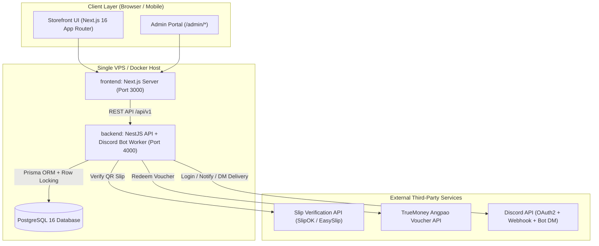
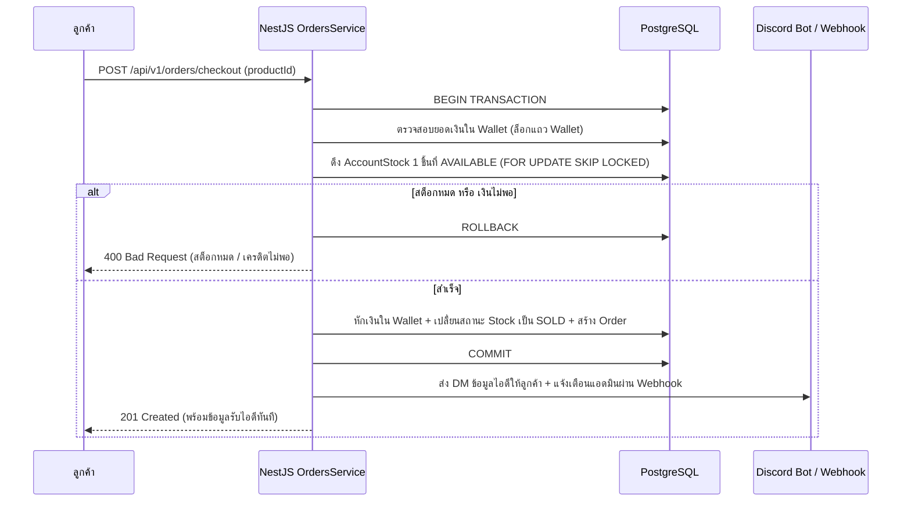

# KizortShop (KAITAN STORE) — SME Architecture Scope & Route Plan

เอกสารฉบับนี้เป็นข้อกำหนดสถาปัตยกรรมระบบ (Architecture Scope), แผนผังเส้นทางทั้งหมด (Frontend, Admin Portal, Backend API Route Map) และข้อกำหนดด้านความปลอดภัยสำหรับธุรกิจขนาด SME ของ **KizortShop (KAITAN STORE)** เพื่อให้การพัฒนาทั้งฝั่ง `frontend/` และ `backend/` เดินไปในทิศทางเดียวกัน ไม่ซับซ้อนเกินความจำเป็น (No Over-engineering) และพร้อมใช้งานจริงในเชิงพาณิชย์

---

## 1. ขอบเขตสถาปัตยกรรมระดับ SME (SME System Scope & Sizing)

### 1.1 เป้าหมายการรองรับปริมาณงาน (Target Capacity: 6–12 เดือนแรก)
| ตัวชี้วัด (Metric) | เป้าหมายการรองรับ (Target Scale) | แนวทางสถาปัตยกรรมที่เลือกใช้ |
| :--- | :--- | :--- |
| **ยอดคำสั่งซื้อต่อวัน** | สูงสุด 500 รายการ / วัน | ใช้ Monolith Backend (NestJS) ตัวเดียว ไม่ต้องแยก Microservices |
| **ผู้ใช้งานพร้อมกัน (Concurrent Users)** | ไม่เกิน 200 คนพร้อมกัน | Next.js 16 (SSR + Partial Prerendering) ลดภาระการดึงข้อมูลซ้ำ |
| **ผู้ดูแลระบบ (Admins)** | 1–3 คน | จัดการผ่าน `/admin/*` พร้อมระบบบันทึกประวัติการแก้ไข (Admin Audit Log) |
| **เซิร์ฟเวอร์และฐานข้อมูล** | Single VPS (2–4 vCPU, 4–8 GB RAM) + Single PostgreSQL | รันผ่าน Docker Compose บนเครื่องเดียว ประหยัดงบรายเดือนและดูแลรักษาง่าย |

### 1.2 แผนผังโครงสร้างระบบ (System Topology)

---

## 2. แผนผังเส้นทางฝั่งหน้าร้านและสมาชิก (Storefront & Member Route Map)

ทุกหน้าภายใต้กลุ่ม `(store)` และ `/member` ใช้โครงสร้าง `AppShell` ร่วมกัน และควบคุมทิศทางผ่าน [`navigation.ts`](file:///e:/ouroboros-study/kaitan-store/frontend/src/config/navigation.ts)

| Route Path | ชื่อหน้าเพจ | สถานะปัจจุบัน | หน้าที่หลักและขอบเขตการทำงาน (Scope) |
| :--- | :--- | :--- | :--- |
| `/` | หน้าแรก (Landing Page) | สร้างแล้ว | แบนเนอร์โปรโมชั่น, แถบประกาศ (`AnnouncementBar`), รายการซื้อล่าสุด (`OrderTicker`), หมวดหมู่เกม, สินค้าขายดี, รีวิวลูกค้า |
| `/products` | สินค้าทั้งหมด (Catalog) | สร้างแล้ว | ค้นหาและกรองสินค้าตามหมวดหมู่ (`?category=`), เรียงราคา, แสดงสถานะสต็อกแบบเรียลไทม์ |
| `/products/[id]` | รายละเอียดสินค้า (Product Detail) | **ต้องเพิ่มใหม่** | แสดงภาพสินค้าหลายมุม, รายละเอียดสเปคไอดีเกม, เงื่อนไขการรับประกัน 24 ชม., สินค้าใกล้เคียง และปุ่มกดซื้อด่วน |
| `/gacha` | สุ่มของรางวัล / กล่องสุ่ม (Gacha Box) | **ต้องเพิ่มใหม่** | หน้าสุ่มไอดีเกมและสุ่มพอยท์ แสดงอัตราการดรอป (Drop Rate %) โปร่งใส พร้อมแอนิเมชันเปิดกล่องและตัดพอยท์อัตโนมัติ |
| `/topup` | เติมเครดิต (Top-up Wallet) | สร้างแล้ว | เลือกช่องทางเติมเงิน PromptPay QR (สแกนสลิปอัตโนมัติ), ซองของขวัญ TrueMoney และโหมดแจ้งโอนให้แอดมินตรวจเมื่อ API ล่ม |
| `/redeem` | กรอกโค้ดส่วนลด / คูปอง (Redeem Code) | **ต้องเพิ่มใหม่** | หน้าสำหรับกรอกโค้ดกิจกรรมเพื่อรับพอยท์ฟรี หรือรับคูปองส่วนลดเข้าบัญชีสมาชิก |
| `/orders` | ประวัติการสั่งซื้อและรับไอดี (Order History) | สร้างแล้ว | แสดงรายการที่ซื้อสำเร็จ, ปุ่มคัดลอก `USERNAME:PASSWORD`, ตัวนับเวลาถอยหลังรับประกัน 24 ชม., และปุ่มกดแจ้งเคลมทันที |
| `/support` | แจ้งปัญหาและเคลมสินค้า (Support & Claim) | สร้างแล้ว | เปิด Ticket แจ้งปัญหาไอดีเข้าไม่ได้ แนบเลขออเดอร์และรูปหลักฐาน พร้อมติดตามสถานะการตรวจสอบของแอดมิน |
| `/member/profile` | โปรไฟล์สมาชิก (Member Profile) | สร้างแล้ว | ดูยอดเครดิตคงเหลือ, สถานะการเชื่อมบัญชี Discord, ประวัติการเติมเงิน และเปลี่ยนรหัสผ่าน |

---

## 3. แผนผังเส้นทางฝั่งผู้ดูแลระบบ (Admin Portal Route Map)

หน้าผู้ดูแลระบบทั้งหมดอยู่ภายใต้ `/admin/*` บังคับตรวจสิทธิ์ `Role.ADMIN` ทุกครั้งทั้งฝั่ง Frontend Middleware และ Backend Guard

| Route Path | ชื่อหน้าจัดการ | สถานะปัจจุบัน | หน้าที่หลักและขอบเขตการทำงาน (Scope) |
| :--- | :--- | :--- | :--- |
| `/admin/dashboard` | ภาพรวมระบบ (Overview) | สร้างแล้ว | สรุปยอดขายรายวัน/รายเดือน, จำนวนออเดอร์, สต็อกใกล้หมด, และทางลัดจัดการด่วน (Bento Grid Layout) |
| `/admin/products` | จัดการสินค้าและบริการ | สร้างแล้ว | เพิ่ม/แก้ไข/ซ่อนสินค้า, ตั้งราคาปกติและราคาลด, และสวิตช์เปิด-ปิดสถานะบริการ Robux อัตโนมัติ (`AVAILABLE` / `OUT_OF_STOCK`) |
| `/admin/stocks` | คลังสต็อกไอดีเกม (Stock Vault) | สร้างแล้ว | นำเข้าไอดีเกมแบบหลายบรรทัด (Bulk Import `user:pass`), กรองตามสถานะ (`AVAILABLE`, `RESERVED`, `SOLD`), ค้นหาและลบสต็อกที่เสีย |
| `/admin/orders` | รายการคำสั่งซื้อทั้งหมด | สร้างแล้ว | ตรวจสอบประวัติการซื้อของลูกค้าทุกคน, ดูว่าออเดอร์ไหนได้รับสต็อกชุดใด, และกดคืนเงิน (`REFUNDED`) กรณีเคลมผ่าน |
| `/admin/topups` | รายการเติมเงินและตรวจสลิป | สร้างแล้ว | ตรวจสอบรายการเติมเงินทั้งหมด, ดูรูปสลิปโอนเงิน, และกดอนุมัติ (`SUCCESS`) หรือปฏิเสธ (`REJECTED`) ในโหมด Manual Fallback |
| `/admin/users` | จัดการสมาชิกและเครดิต | สร้างแล้ว | ค้นหาสมาชิก, ปรับเพิ่ม/ลดเครดิตพร้อมระบุเหตุผล, เปลี่ยนบทบาท (`MEMBER` / `ADMIN`), และระงับบัญชีที่มีพฤติกรรมทุจริต |
| `/admin/categories` | จัดการหมวดหมู่เกม | สร้างแล้ว | เพิ่ม/แก้ไข/ซ่อนหมวดหมู่เกม, อัปโหลดรูปปก 16:9, และนับจำนวนสต็อกสินค้าที่ผูกอยู่ |
| `/admin/banners` | แบนเนอร์ & ประกาศหน้าร้าน | สร้างแล้ว | ควบคุมภาพสไลด์ Hero Carousel หน้าแรก, จัดเรียงลำดับสไลด์ (Reorder), ตั้งค่าปุ่ม CTA, และเปิด/ปิดการแสดงผล |
| `/admin/coupons` | จัดการโค้ดส่วนลดและพอยท์ฟรี | **ต้องเพิ่มใหม่** | สร้างโค้ดโปรโมชั่น (กำหนดมูลค่าพอยท์หรือ % ส่วนลด, จำนวนสิทธิ์สูงสุด, จำกัด 1 คนต่อ 1 สิทธิ์, และวันหมดอายุ) |
| `/admin/tickets` | จัดการใบแจ้งเคลมสินค้า | **ต้องเพิ่มใหม่** | ตอบกลับข้อความลูกค้า, ตรวจสอบเวลาประกัน 24 ชม., กดส่งไอดีใหม่ทดแทน (Replace Credential) หรือกดคืนเครดิตเข้ากระเป๋า |
| `/admin/settings` | ตั้งค่าระบบและ Audit Log | **ต้องเพิ่มใหม่** | ตั้งค่าเลขบัญชี PromptPay, เปิด/ปิดโหมดตรวจสลิปอัตโนมัติ, ตั้งค่า Discord Webhook/Bot Token, และดูตารางประวัติการกระทำของแอดมิน (Audit Log) |

---

## 4. แผนผัง API ฝั่ง Backend (NestJS `/api/v1/*` Endpoint Plan)

โครงสร้าง Backend แบ่งเป็นโมดูลตามโดเมนธุรกิจ (`backend/src/modules/*`) โดยใช้ Prisma ORM เชื่อมต่อ PostgreSQL

### 4.1 Authentication & Discord OAuth2 (`/api/v1/auth`)
- `POST /api/v1/auth/register` — สมัครสมาชิกด้วย Username, Email, Password
- `POST /api/v1/auth/login` — เข้าสู่ระบบ รับ JWT Access Token (HttpOnly Cookie / Bearer)
- `GET /api/v1/auth/discord` — ส่งผู้ใช้ไปหน้ายืนยันตัวตน Discord OAuth2
- `GET /api/v1/auth/discord/callback` — รับข้อมูลจาก Discord สร้างหรือเชื่อมบัญชีผู้ใช้ (`discordId`) อัตโนมัติ
- `GET /api/v1/auth/me` — ดึงข้อมูลผู้ใช้ปัจจุบันพร้อมยอดเงินใน `Wallet`

### 4.2 Catalog, Products & Gacha (`/api/v1/categories`, `/api/v1/products`, `/api/v1/gacha`)
- `GET /api/v1/categories` — ดึงหมวดหมู่ทั้งหมดพร้อมจำนวนสินค้าที่ยังมีสต็อก
- `GET /api/v1/products` — ดึงรายการสินค้า (รองรับ `?category=`, `?search=`, `?sort=`) พร้อมนับเฉพาะสต็อกที่ `status = AVAILABLE`
- `GET /api/v1/products/:id` — ดึงรายละเอียดสินค้ารายชิ้น
- `GET /api/v1/gacha/boxes` — ดึงรายการกล่องสุ่มและอัตราการดรอป
- `POST /api/v1/gacha/boxes/:id/spin` — กดสุ่มรางวัล (ตัดเครดิตและสุ่มแบบ ถ่วงน้ำหนัก Server-side RNG ใน Transaction เดียว)

### 4.3 Atomic Checkout & Orders (`/api/v1/orders`)
- `POST /api/v1/orders/checkout` — สั่งซื้อสินค้าด้วยเครดิตในกระเป๋า (ใช้ Database Row-Level Lock ป้องกันไอดีซ้ำ)
- `GET /api/v1/orders/my` — ดึงประวัติการสั่งซื้อของตนเอง (ถอดรหัส `credentials` เฉพาะเจ้าของออเดอร์)
- `GET /api/v1/orders/recent-ticker` — ดึงรายการสั่งซื้อล่าสุด 10 รายการแบบปกปิดชื่อผู้ซื้อ (สำหรับแสดงใน `OrderTicker` หน้าแรก)

### 4.4 Wallet, Top-up & Coupons (`/api/v1/payments`, `/api/v1/coupons`)
- `POST /api/v1/payments/slip-verify` — อัปโหลดรูปสลิปหรือ Payload QR เพื่อตรวจสอบกับ API (SlipOK / EasySlip) และเติมเงินอัตโนมัติ
- `POST /api/v1/payments/truemoney-angpao` — ส่งลิงก์ซองของขวัญ TrueMoney เพื่อรับเงินเข้ากระเป๋า
- `POST /api/v1/payments/manual-slip` — แจ้งโอนเงินพร้อมแนบสลิปเข้าคิว `PENDING_VERIFY` (กรณีระบบ API ภายนอกขัดข้อง)
- `POST /api/v1/coupons/redeem` — กรอกโค้ดเพื่อรับเครดิตฟรีหรือส่วนลด

### 4.5 Support Tickets (`/api/v1/tickets`)
- `POST /api/v1/tickets` — เปิดใบแจ้งเคลมสินค้า (ตรวจสอบเงื่อนไขว่าออเดอร์ยังไม่เกิน 24 ชั่วโมง)
- `GET /api/v1/tickets/my` — ดูสถานะใบแจ้งเคลมของตนเอง

### 4.6 Admin Management Endpoints (`/api/v1/admin/*`)
- `GET /api/v1/admin/stats` — ข้อมูลสรุปยอดขายและกราฟสำหรับหน้า Dashboard
- `POST / PUT / DELETE /api/v1/admin/products` — จัดการสินค้าและสถานะบริการ Robux
- `POST / DELETE /api/v1/admin/stocks` — นำเข้าสต็อกแบบ Bulk Import (เข้ารหัส AES-256 ก่อนลง DB) และลบสต็อก
- `PATCH /api/v1/admin/topups/:id/approve` | `reject` — อนุมัติหรือปฏิเสธสลิปโอนเงิน
- `PATCH /api/v1/admin/users/:id/balance` — ปรับยอดเงินสมาชิกพร้อมบันทึกเหตุผลลง `AuditLog`
- `POST / PATCH /api/v1/admin/coupons` — สร้างและเปิด/ปิดโค้ดคูปอง
- `PATCH /api/v1/admin/tickets/:id/resolve` — ตัดสินผลการเคลม (เปลี่ยนไอดีใหม่ หรือ คืนเครดิต)
- `GET / PUT /api/v1/admin/settings` — ตั้งค่าระบบและดึงรายการ `AuditLog`

---

## 5. กลไกสำคัญที่ต้องมีสำหรับร้านค้า SME (Essential SME Safeguards)

เพื่อให้ร้านค้าทำงานได้อัตโนมัติ 24 ชั่วโมงโดยที่เจ้าของร้านไม่ต้องเฝ้าหน้าจอตลอดเวลา ระบบจะต้องมีกลไกป้องกันความเสียหาย 5 ข้อดังนี้:

### 5.1 การป้องกันการซื้อไอดีซ้ำ (Atomic Stock Reservation)
เมื่อลูกค้าสองคนกดซื้อสินค้าชิ้นเดียวกันในเสี้ยววินาทีเดียวกัน ระบบห้ามจ่ายไอดีเดียวกันเด็ดขาด ขั้นตอนการสั่งซื้อใน `OrdersService` ต้องทำงานภายใต้ Prisma Interactive Transaction (`prisma.$transaction`) และใช้ `SELECT ... FOR UPDATE SKIP LOCKED`:

### 5.2 การป้องกันสลิปซ้ำและสลิปปลอม (Anti-Fraud Slip Verification)
1. **เก็บค่า `slipRef` (Transaction Reference ของธนาคาร) เป็น `@unique` ในตาราง `TopupTransaction`**: หากมีคนนำสลิปเดิมมาอัปโหลดซ้ำ Database จะปฏิเสธทันทีในระดับ Constraint
2. **ตรวจสอบชื่อบัญชีและเลขพร้อมเพย์ผู้รับโอน**: ข้อมูลที่ตอบกลับจาก API ตรวจสลิปต้องตรงกับบัญชีร้านค้าที่ตั้งไว้ในระบบเท่านั้น
3. **Rate Limiting**: จำกัดการยิง API ตรวจสลิปและกรอกคูปองไม่เกิน 5 ครั้งต่อนาทีต่อ 1 IP/User เพื่อป้องกันการสุ่มเดาโค้ดหรือยิงสแปมตัดโควตา API

### 5.3 การเข้ารหัสข้อมูลไอดีเกม (AES-256-GCM Credential Encryption)
- รหัสผ่านเกมในตาราง `AccountStock.credentials` จะไม่ถูกเก็บเป็นข้อความธรรมดา (Plaintext) ลงฐานข้อมูล
- ก่อนบันทึก: เข้ารหัสด้วยกุญแจ `STOCK_ENCRYPTION_KEY` จากไฟล์ `.env`
- ตอนแสดงผล: ถอดรหัสเฉพาะเมื่อผู้เรียกคือเจ้าของ `Order` นั้น หรือเป็นแอดมินที่มีสิทธิ์ตรวจสอบ

### 5.4 ระบบนับเวลารับประกัน 24 ชั่วโมง (24-Hour Warranty Window)
- อ้างอิงจาก `Order.createdAt` เมื่อลูกค้าซื้อไอดีไป ระบบจะคำนวณ `warrantyExpiresAt = createdAt + 24 hours`
- ในหน้า `/orders` จะแสดงสถานะ "อยู่ในระยะรับประกัน (เหลือเวลา XX ชม.)" หากพ้น 24 ชั่วโมงไปแล้ว ปุ่มแจ้งเคลมอัตโนมัติจะถูกล็อกเพื่อลดภาระแอดมินจากการเคลมย้อนหลังผิดเงื่อนไข

### 5.5 ระบบบันทึกประวัติแอดมินและการสำรองฐานข้อมูล (Admin Audit Log & Daily Backup)
1. **Admin Audit Log**: เมื่อแอดมินมีตั้งแต่ 1–3 คนขึ้นไป ทุกการกดเพิ่มเครดิตฟรี, ลบสต็อก, หรืออนุมัติสลิปมือ จะต้องถูกบันทึกว่า `แอดมินคนใด` ทำอะไร เวลาไหน และแก้ไขค่าจากเท่าไหร่เป็นเท่าไหร่
2. **Automated Daily DB Backup**: ตั้ง Cron Job ใน NestJS เวลา 03:00 น. ของทุกวันเพื่อ Dump ข้อมูลสำคัญและส่งไฟล์สำรองหรือรายงานสรุปยอดขายประจำวันเข้าห้อง Discord ลับของเจ้าของร้าน

---

## 6. ส่วนขยายตารางฐานข้อมูลที่ต้องเพิ่มเติม (Prisma Schema Additions)

จากไฟล์ [`backend/prisma/schema.prisma`](file:///e:/ouroboros-study/kaitan-store/backend/prisma/schema.prisma) ปัจจุบัน เมื่อเริ่มเชื่อมระบบจริงให้เพิ่มฟิลด์และตารางดังนี้เพื่อให้รองรับทุก Route ที่วางแผนไว้:

1. **เพิ่มฟิลด์ใน `User`**:
   - `discordId String? @unique` (สำหรับ Discord OAuth2 และส่ง DM รับไอดี)
   - `isActive Boolean @default(true)` (สำหรับแบนผู้ใช้ที่ทุจริต)
2. **ปรับปรุง `TopupTransaction`**:
   - ตั้ง `slipRef String? @unique` เพื่อป้องกันการใช้สลิปซ้ำระดับฐานข้อมูล
   - เพิ่ม `verifiedById String?` เพื่อระบุแอดมินกรณีอนุมัติสลิปด้วยมือ
3. **ตารางใหม่ `Coupon` และ `CouponRedemption`**:
   - เก็บรหัสคูปอง, ประเภท (`CREDIT` หรือ `DISCOUNT`), จำนวนสิทธิ์สูงสุด (`maxUses`), จำนวนที่ใช้ไปแล้ว (`usedCount`), และวันหมดอายุ (`expiresAt`)
4. **ตารางใหม่ `GachaBox` และ `GachaItem`**:
   - เก็บข้อมูลกล่องสุ่ม, ราคาต่อครั้ง, และรายการของรางวัลพร้อมค่าน้ำหนักความน่าจะเป็น (`weight`)
5. **ตารางใหม่ `AuditLog`**:
   - เก็บ `adminId`, `action` (เช่น `ADJUST_BALANCE`, `APPROVE_TOPUP`, `IMPORT_STOCK`), `targetId`, `metadata` (JSON), และ `createdAt`
6. **ตารางใหม่ `SystemSetting`**:
   - เก็บค่าคอนฟิกแบบ Key-Value เช่น สถานะเปิด/ปิดระบบตรวจสลิปอัตโนมัติ, ข้อความประกาศหน้าร้าน, และสถานะเปิด/ปิดบริการ Robux

---

## 7. ลำดับการพัฒนาต่อจากนี้ (Implementation Roadmap)

1. **Phase 1 — เติมเต็มหน้า Frontend และ Admin ที่ยังขาด**:
   - สร้างหน้า Storefront ที่เพิ่งกำหนดเพิ่ม: `/products/[id]`, `/gacha`, `/redeem`
   - สร้างหน้า Admin ที่เพิ่งกำหนดเพิ่ม: `/admin/catalog`, `/admin/coupons`, `/admin/tickets`, `/admin/settings`
   - อัปเดต [`navigation.ts`](file:///e:/ouroboros-study/kaitan-store/frontend/src/config/navigation.ts) ให้เชื่อมโยงทุกหน้าเข้าด้วยกันอย่างสมบูรณ์
2. **Phase 2 — อัปเกรด Prisma Schema และสร้าง Core Backend (NestJS)**:
   - อัปเดต `schema.prisma` และรัน Migration บน PostgreSQL
   - ทำระบบ Auth (JWT + Discord OAuth2) และระบบเข้ารหัสสต็อก AES-256
   - ทำระบบ Atomic Checkout (`OrdersService`) และระบบเติมเงิน (Slip API + TrueMoney + Manual Fallback)
3. **Phase 3 — เชื่อมระบบ Discord Bot & Webhooks และสลับจาก Mock เป็น API จริง**:
   - เชื่อม Discord Bot ส่ง DM รหัสเกมให้ลูกค้าอัตโนมัติหลังซื้อเสร็จ
   - เปลี่ยนค่า `NEXT_PUBLIC_USE_MOCKS=false` เพื่อเชื่อมต่อ Frontend เข้ากับ Backend เต็มรูปแบบ
